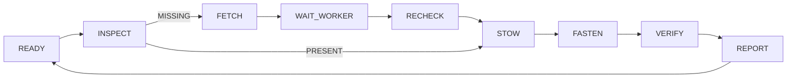

# P0-a 아키텍처

| 패키지 | 책임 |
|---|---|
| core_interfaces | Action, Service, Message 정의와 코드 생성 |
| core_common | 공통 판정, 오류, API 계약과 로깅 |
| core_control | 단일 Assembly Task FSM, CLI, 상태·결과 발행과 JSONL, 선택 GUI |
| core_robot | 로봇 Action 독점 실행, Fake 알고리즘, Episode 기록 |
| core_vision | 상단·측면 검사와 물품 위치 서비스, 실물 템플릿 |
| core_language | 음성·LLM 연동 자리와 계약 |
| core_bringup | 실행 모드, 시나리오, 시간 제한과 설정 템플릿 |

관제는 검사 뷰로 이동한 뒤 Vision에 판정을 요청합니다. 볼트가 없으면 볼트와 드라이버를 인계대에 전달하고 작업자 완료를 기다립니다. 재검사와 이동 허가를 거쳐 드라이버를 거치하고 마무리 체결을 수행합니다. 볼트가 처음부터 있으면 측면 검사 결과에 따라 마무리 체결 또는 확인 조임을 선택합니다.

판정 불명과 센서 불일치는 HOLD, 미체결은 FAIL로 기록합니다. 정지는 래치되며 명시적 복구가 필요합니다. 실행 중 오류나 취소로 종료된 작업도 사유를 기록합니다. 관제는 DB와 LLM의 응답을 기다리지 않습니다. GUI는 토픽을 직접 구독합니다.
