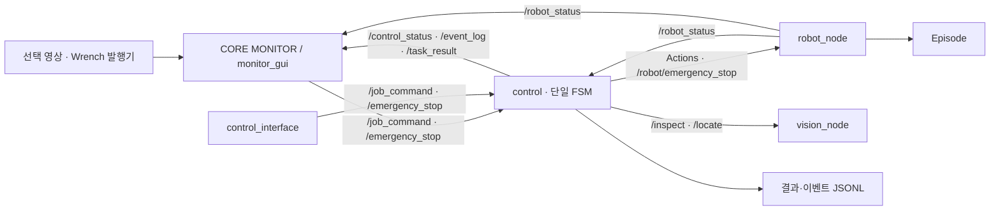
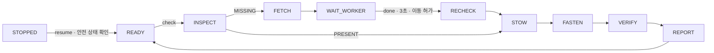

# 관제 코어 아키텍처

| 패키지 | 책임 |
|---|---|
| core_interfaces | Action, Service, Message 정의와 코드 생성 |
| core_common | 공통 판정, 오류, API 계약과 로깅 |
| core_control | `control`의 단일 Assembly Task FSM과 JSONL, CLI, 별도 프로세스인 CORE MONITOR |
| core_robot | 로봇 Action 공통 실행 슬롯, Fake 알고리즘, Episode 기록 |
| core_vision | Fake 상단·측면 검사와 물품 위치 서비스, 실물 템플릿 |
| core_language | 음성·LLM 연동 자리와 계약 |
| core_bringup | Fake 통합 Launch, 선택 GUI·음성·LLM 노드와 설정 |

## 노드와 데이터 흐름

`control`이 작업 순서, 이동 허가 확인, 상태 전이와 최종 판정을 결정합니다. CORE MONITOR는 상태·결과·로그를 구독하고 동일한 관제 명령 서비스를 비동기로 호출합니다. 화면은 ROS 콜백과 이미지 디코딩을 별도 스레드에서 처리한 뒤 Tk 스레드에서 갱신합니다. 선택 센서 입력은 GUI 표시용이며 관제 판정은 Vision Service와 Fasten Action 결과를 사용합니다. 관제는 DB나 LLM의 응답을 기다리지 않습니다. [통신 계약](INTERFACES.md)

## 작업 흐름

관제는 검사 뷰로 이동한 뒤 Vision에 판정을 요청합니다. 누락 경로는 RECHECK에서 상단과 측면을 검사하고, 볼트가 처음부터 있으면 INSPECT에서 두 검사를 수행합니다. 측면 판정에 따라 마무리 체결 또는 확인 조임을 선택합니다. 판정 불명, 센서 불일치와 취소는 HOLD이며, 미체결은 FAIL입니다. 정지 시에는 STOPPED를 유지하면서 결과를 기록합니다. 명시적으로 복귀한 뒤에는 READY에서 새 작업을 받을 수 있습니다.
